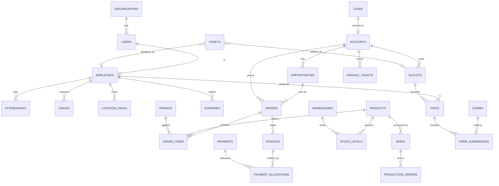

# ERP / Field Operations Platform

A multi-tenant ERP with field-force management: employees are tracked in the field, visit outlets, capture leads and orders, collect payments, and file expenses, while back-office teams manage inventory, production, finance and reporting.

---

## Table of Contents

1. [Module Overview](#module-overview)
2. [Module Functions](#module-functions)
3. [Entity Relationship Overview](#entity-relationship-overview)
4. [Database Schema (PostgreSQL)](#database-schema-postgresql)
5. [Cross-Module Flows](#cross-module-flows)
6. [Suggested Build Order](#suggested-build-order)

---

## Module Overview

| Group | Modules |
|---|---|
| Home | Dashboard, Announcements, Activity Feed |
| People | Employees, Attendances, Leaves |
| Operations | Maps, Tracking, Outlets, Visits |
| Sales & CRM | Opportunities, Leads, Accounts, Sales, Orders, Promos |
| Inventory | Products, Inventory, Production, Assets |
| Finance | Expenses, Billing and Collection |
| Tools | Data Import/Export, Digital Forms, Service Tickets, Reports & Analytics (Reports, Reports Builder) |
| System | Administration, Master Data |

---

## Module Functions

### Home

**Dashboard**
Role-aware landing page with KPI widgets: attendance today, visits completed vs. planned, sales vs. target, open orders, collections due, pending approvals, open tickets. Widgets are configurable per role.

**Announcements**
Broadcast company or team messages. Supports targeting by role, department, region or team, scheduling (publish/expire dates), attachments, pinning, and read receipts / acknowledgement.

**Activity Feed**
Chronological stream of system events (new order, visit checked-in, leave approved, expense submitted). Built from the audit/event log, filterable by user, module and date. Supports comments and mentions.

### People

**Employees**
Employee master: profile, job position, department, reporting manager, employment status, documents, emergency contacts, territory/route assignment, device binding for the mobile app. Drives user accounts and org hierarchy.

**Attendances**
Clock in/out (mobile with GPS + selfie, or web), shift schedules, late/early/overtime computation, geofence validation, manual correction requests with approval, daily/monthly attendance summaries.

**Leaves**
Leave types (vacation, sick, etc.), accrual and balances, leave requests, multi-level approval workflow, calendar view, holiday calendar, and integration with attendance (approved leave marks the day as excused).

### Operations

**Maps**
Geospatial view of outlets, employees' live/last-known locations, territories and routes. Filter by region, team, outlet type or status. Supports geofence/territory drawing and route visualization.

**Tracking**
Periodic GPS pings from the mobile app during working hours. Provides live location, historical trail playback, distance travelled, idle time, and out-of-territory / geofence alerts.

**Outlets**
Store/customer-location master: name, address, coordinates, channel/type, tier, owner/contacts, assigned account, assigned route and visit frequency, photos, status (active/prospect/closed).

**Visits**
Planned and ad-hoc field visits to outlets. Includes visit plans/routes, check-in/out with geolocation and time-on-site, tasks performed (order taking, stock check, collection, form completion, photos), visit notes, and compliance reporting (planned vs. actual).

### Sales & CRM

**Leads**
Capture and qualify prospects (source, owner, status, score). Assign/reassign, log activities, and convert to Account + Contact + Opportunity.

**Accounts**
Customer/company master: legal info, billing/shipping addresses, contacts, credit limit and terms, price list, assigned salesperson, linked outlets, and account history (orders, invoices, balances).

**Opportunities**
Sales pipeline: stages, expected value, probability, close date, owner, competitors, products of interest. Kanban + forecast views; won opportunities can generate orders.

**Orders**
Sales orders (created in field or back-office): line items, pricing, discounts/promos, taxes, delivery date, status workflow (draft → submitted → approved → fulfilled → closed/cancelled). Reserves/allocates inventory and feeds invoicing.

**Sales**
Recorded sales transactions/sell-out (invoices, van-sales, point-of-sale entries) and performance tracking: sales by product/outlet/rep/region, targets vs. achievement, returns and credit memos.

**Promos**
Promotion definitions: type (percent/amount discount, buy-X-get-Y, bundle, free item), validity window, eligibility (outlet type, account, region, product), budget caps, stacking rules. Auto-applied or suggested during order entry; tracks redemptions and ROI.

### Inventory

**Products**
Product/SKU catalog: categories, brand, UoM and conversions, barcodes, price lists, tax class, images, product type (finished/raw/service), bill of materials link, active status.

**Inventory**
Stock management by warehouse/van/location: on-hand, reserved, available, batch/lot and expiry, stock movements (receipt, issue, transfer, adjustment, return), reorder levels, stock counts, and valuation.

**Production**
Manufacturing/assembly: BOMs, production orders, material consumption, finished-goods output, yield/scrap, and status tracking. Consumes raw materials and produces stock movements.

**Assets**
Company asset register (vehicles, devices, equipment, merchandising fixtures such as coolers/displays): tag, category, purchase info, depreciation, assignment to employee or outlet, maintenance schedule, status and location history.

### Finance

**Expenses**
Employee expense claims (travel, meals, fuel, etc.) with receipt attachments, categories, per-diem/mileage rules, linkage to visits or trips, approval workflow, reimbursement status and policy checks.

**Billing and Collection**
Invoice generation from orders/sales, payment terms, receivables aging, payment recording (cash, check, transfer, e-wallet) including field collections, allocation of payments to invoices, deposits/remittance reconciliation, statements, and overdue follow-up.

### Tools

**Data Import/Export**
Bulk CSV/XLSX import with templates, field mapping, validation and error reports; scheduled or on-demand exports for any module; job history.

**Digital Forms**
Configurable forms (surveys, audits, checklists, merchandising/shelf checks, KYC) with field types, conditional logic, photo/signature/GPS capture, offline fill-in on mobile, and attachment to visits, outlets or tickets. Submissions are stored and reportable.

**Service Tickets**
Support/issue tracking tied to accounts, outlets, assets or products: categories, priority, SLA timers, assignment, comments, attachments, status workflow, resolution and customer sign-off.

**Reports & Analytics → Reports**
Prebuilt operational and management reports (attendance, visit compliance, sales performance, aging, stock, expenses), with filters, scheduling, and PDF/Excel export.

**Reports & Analytics → Reports Builder**
Self-service report designer: choose a data source, columns, filters, grouping, aggregations, and chart type; save, share and schedule custom reports.

### System

**Administration**
Users, roles and permissions (RBAC with module/action/data-scope), organization and branch setup, approval workflow configuration, notification templates, integrations/API keys, audit logs, system settings, mobile app configuration.

**Master Data**
Shared reference data: regions/territories, outlet types/channels, UoMs, currencies, tax rates, payment terms, expense categories, leave types, ticket categories, lead sources, reasons, and other lookups.

---

## Entity Relationship Overview



---

## Database Schema (PostgreSQL)

Conventions:
- Every business table has `org_id` (multi-tenant), `created_at`, `updated_at`, and `created_by` where relevant; soft delete via `deleted_at`.
- Primary keys are UUIDs.
- Status columns use `text` + `CHECK` (swap for enums or master-data lookups as preferred).
- Geo columns use PostGIS `geography(Point, 4326)`; if PostGIS isn't available use `lat`/`lng` numerics.

```sql
CREATE EXTENSION IF NOT EXISTS "pgcrypto";
CREATE EXTENSION IF NOT EXISTS postgis;

-- ============================================================
-- SYSTEM: ADMINISTRATION
-- ============================================================
CREATE TABLE organizations (
  id            uuid PRIMARY KEY DEFAULT gen_random_uuid(),
  name          text NOT NULL,
  code          text UNIQUE NOT NULL,
  timezone      text NOT NULL DEFAULT 'UTC',
  currency_code text NOT NULL DEFAULT 'USD',
  settings      jsonb NOT NULL DEFAULT '{}',
  created_at    timestamptz NOT NULL DEFAULT now(),
  updated_at    timestamptz NOT NULL DEFAULT now()
);

CREATE TABLE roles (
  id          uuid PRIMARY KEY DEFAULT gen_random_uuid(),
  org_id      uuid NOT NULL REFERENCES organizations(id),
  name        text NOT NULL,
  description text,
  UNIQUE (org_id, name)
);

CREATE TABLE permissions (
  id      uuid PRIMARY KEY DEFAULT gen_random_uuid(),
  module  text NOT NULL,          -- e.g. 'orders'
  action  text NOT NULL,          -- view|create|update|delete|approve|export
  UNIQUE (module, action)
);

CREATE TABLE role_permissions (
  role_id       uuid REFERENCES roles(id) ON DELETE CASCADE,
  permission_id uuid REFERENCES permissions(id) ON DELETE CASCADE,
  data_scope    text NOT NULL DEFAULT 'own'
                CHECK (data_scope IN ('own','team','territory','org')),
  PRIMARY KEY (role_id, permission_id)
);

CREATE TABLE users (
  id            uuid PRIMARY KEY DEFAULT gen_random_uuid(),
  org_id        uuid NOT NULL REFERENCES organizations(id),
  email         text NOT NULL,
  password_hash text,
  full_name     text NOT NULL,
  status        text NOT NULL DEFAULT 'active' CHECK (status IN ('active','suspended','invited')),
  last_login_at timestamptz,
  created_at    timestamptz NOT NULL DEFAULT now(),
  updated_at    timestamptz NOT NULL DEFAULT now(),
  UNIQUE (org_id, email)
);

CREATE TABLE user_roles (
  user_id uuid REFERENCES users(id) ON DELETE CASCADE,
  role_id uuid REFERENCES roles(id) ON DELETE CASCADE,
  PRIMARY KEY (user_id, role_id)
);

CREATE TABLE audit_logs (
  id          bigserial PRIMARY KEY,
  org_id      uuid NOT NULL,
  user_id     uuid REFERENCES users(id),
  module      text NOT NULL,
  entity_type text NOT NULL,
  entity_id   uuid,
  action      text NOT NULL,        -- create|update|delete|approve|login...
  changes     jsonb,
  ip_address  inet,
  created_at  timestamptz NOT NULL DEFAULT now()
);
CREATE INDEX ON audit_logs (org_id, module, created_at DESC);
CREATE INDEX ON audit_logs (entity_type, entity_id);

CREATE TABLE approval_workflows (
  id       uuid PRIMARY KEY DEFAULT gen_random_uuid(),
  org_id   uuid NOT NULL REFERENCES organizations(id),
  module   text NOT NULL,           -- leaves|expenses|orders|attendance_correction
  name     text NOT NULL,
  steps    jsonb NOT NULL,          -- [{level:1, approver_type:'manager'|'role'|'user', ref:...}]
  is_active boolean NOT NULL DEFAULT true
);

CREATE TABLE approvals (
  id            uuid PRIMARY KEY DEFAULT gen_random_uuid(),
  org_id        uuid NOT NULL,
  workflow_id   uuid REFERENCES approval_workflows(id),
  entity_type   text NOT NULL,
  entity_id     uuid NOT NULL,
  level         int  NOT NULL,
  approver_id   uuid REFERENCES users(id),
  status        text NOT NULL DEFAULT 'pending' CHECK (status IN ('pending','approved','rejected','skipped')),
  remarks       text,
  acted_at      timestamptz
);
CREATE INDEX ON approvals (entity_type, entity_id);

CREATE TABLE notifications (
  id         uuid PRIMARY KEY DEFAULT gen_random_uuid(),
  org_id     uuid NOT NULL,
  user_id    uuid NOT NULL REFERENCES users(id),
  title      text NOT NULL,
  body       text,
  link       text,
  read_at    timestamptz,
  created_at timestamptz NOT NULL DEFAULT now()
);

-- ============================================================
-- SYSTEM: MASTER DATA
-- ============================================================
CREATE TABLE master_data_types (
  id     uuid PRIMARY KEY DEFAULT gen_random_uuid(),
  org_id uuid NOT NULL REFERENCES organizations(id),
  code   text NOT NULL,             -- outlet_type, lead_source, payment_term, ticket_category...
  name   text NOT NULL,
  UNIQUE (org_id, code)
);

CREATE TABLE master_data_items (
  id        uuid PRIMARY KEY DEFAULT gen_random_uuid(),
  type_id   uuid NOT NULL REFERENCES master_data_types(id) ON DELETE CASCADE,
  code      text NOT NULL,
  label     text NOT NULL,
  metadata  jsonb NOT NULL DEFAULT '{}',
  sort_order int NOT NULL DEFAULT 0,
  is_active boolean NOT NULL DEFAULT true,
  UNIQUE (type_id, code)
);

CREATE TABLE territories (
  id        uuid PRIMARY KEY DEFAULT gen_random_uuid(),
  org_id    uuid NOT NULL REFERENCES organizations(id),
  parent_id uuid REFERENCES territories(id),
  name      text NOT NULL,
  level     text NOT NULL,          -- region|province|city|area
  boundary  geography(Polygon, 4326)
);

CREATE TABLE uoms (
  id     uuid PRIMARY KEY DEFAULT gen_random_uuid(),
  org_id uuid NOT NULL,
  code   text NOT NULL,
  name   text NOT NULL,
  UNIQUE (org_id, code)
);

CREATE TABLE tax_rates (
  id     uuid PRIMARY KEY DEFAULT gen_random_uuid(),
  org_id uuid NOT NULL,
  name   text NOT NULL,
  rate   numeric(6,3) NOT NULL,
  is_inclusive boolean NOT NULL DEFAULT false
);

-- ============================================================
-- PEOPLE
-- ============================================================
CREATE TABLE departments (
  id        uuid PRIMARY KEY DEFAULT gen_random_uuid(),
  org_id    uuid NOT NULL REFERENCES organizations(id),
  parent_id uuid REFERENCES departments(id),
  name      text NOT NULL
);

CREATE TABLE positions (
  id     uuid PRIMARY KEY DEFAULT gen_random_uuid(),
  org_id uuid NOT NULL REFERENCES organizations(id),
  title  text NOT NULL,
  grade  text
);

CREATE TABLE employees (
  id             uuid PRIMARY KEY DEFAULT gen_random_uuid(),
  org_id         uuid NOT NULL REFERENCES organizations(id),
  user_id        uuid UNIQUE REFERENCES users(id),
  employee_no    text NOT NULL,
  first_name     text NOT NULL,
  last_name      text NOT NULL,
  email          text,
  phone          text,
  department_id  uuid REFERENCES departments(id),
  position_id    uuid REFERENCES positions(id),
  manager_id     uuid REFERENCES employees(id),
  territory_id   uuid REFERENCES territories(id),
  hire_date      date,
  status         text NOT NULL DEFAULT 'active' CHECK (status IN ('active','on_leave','resigned','terminated')),
  device_id      text,
  is_field_staff boolean NOT NULL DEFAULT false,
  created_at     timestamptz NOT NULL DEFAULT now(),
  updated_at     timestamptz NOT NULL DEFAULT now(),
  UNIQUE (org_id, employee_no)
);

CREATE TABLE employee_documents (
  id          uuid PRIMARY KEY DEFAULT gen_random_uuid(),
  employee_id uuid NOT NULL REFERENCES employees(id) ON DELETE CASCADE,
  doc_type    text NOT NULL,
  file_url    text NOT NULL,
  expires_on  date
);

CREATE TABLE shifts (
  id          uuid PRIMARY KEY DEFAULT gen_random_uuid(),
  org_id      uuid NOT NULL,
  name        text NOT NULL,
  start_time  time NOT NULL,
  end_time    time NOT NULL,
  grace_minutes int NOT NULL DEFAULT 0
);

CREATE TABLE employee_shifts (
  employee_id uuid REFERENCES employees(id) ON DELETE CASCADE,
  shift_id    uuid REFERENCES shifts(id),
  effective_from date NOT NULL,
  effective_to   date,
  PRIMARY KEY (employee_id, shift_id, effective_from)
);

CREATE TABLE attendances (
  id             uuid PRIMARY KEY DEFAULT gen_random_uuid(),
  org_id         uuid NOT NULL,
  employee_id    uuid NOT NULL REFERENCES employees(id),
  work_date      date NOT NULL,
  clock_in_at    timestamptz,
  clock_out_at   timestamptz,
  clock_in_loc   geography(Point, 4326),
  clock_out_loc  geography(Point, 4326),
  clock_in_photo text,
  status         text NOT NULL DEFAULT 'present'
                 CHECK (status IN ('present','late','absent','half_day','on_leave','holiday')),
  late_minutes   int NOT NULL DEFAULT 0,
  overtime_minutes int NOT NULL DEFAULT 0,
  is_within_geofence boolean,
  remarks        text,
  UNIQUE (employee_id, work_date)
);

CREATE TABLE leave_types (
  id            uuid PRIMARY KEY DEFAULT gen_random_uuid(),
  org_id        uuid NOT NULL,
  name          text NOT NULL,
  is_paid       boolean NOT NULL DEFAULT true,
  annual_quota  numeric(5,2),
  carry_over    boolean NOT NULL DEFAULT false
);

CREATE TABLE leave_balances (
  employee_id   uuid REFERENCES employees(id) ON DELETE CASCADE,
  leave_type_id uuid REFERENCES leave_types(id),
  year          int NOT NULL,
  entitled      numeric(5,2) NOT NULL DEFAULT 0,
  used          numeric(5,2) NOT NULL DEFAULT 0,
  PRIMARY KEY (employee_id, leave_type_id, year)
);

CREATE TABLE leaves (
  id            uuid PRIMARY KEY DEFAULT gen_random_uuid(),
  org_id        uuid NOT NULL,
  employee_id   uuid NOT NULL REFERENCES employees(id),
  leave_type_id uuid NOT NULL REFERENCES leave_types(id),
  start_date    date NOT NULL,
  end_date      date NOT NULL,
  days          numeric(5,2) NOT NULL,
  reason        text,
  status        text NOT NULL DEFAULT 'pending'
                CHECK (status IN ('draft','pending','approved','rejected','cancelled')),
  created_at    timestamptz NOT NULL DEFAULT now()
);

CREATE TABLE holidays (
  id       uuid PRIMARY KEY DEFAULT gen_random_uuid(),
  org_id   uuid NOT NULL,
  name     text NOT NULL,
  holiday_date date NOT NULL,
  UNIQUE (org_id, holiday_date)
);

-- ============================================================
-- SALES & CRM (accounts first; outlets reference them)
-- ============================================================
CREATE TABLE accounts (
  id             uuid PRIMARY KEY DEFAULT gen_random_uuid(),
  org_id         uuid NOT NULL REFERENCES organizations(id),
  account_no     text NOT NULL,
  name           text NOT NULL,
  legal_name     text,
  tax_id         text,
  account_type   text,                         -- master data: distributor, retailer, etc.
  owner_id       uuid REFERENCES employees(id), -- assigned salesperson
  price_list_id  uuid,                         -- FK added after price_lists
  payment_term_days int NOT NULL DEFAULT 0,
  credit_limit   numeric(14,2) NOT NULL DEFAULT 0,
  billing_address  jsonb,
  shipping_address jsonb,
  status         text NOT NULL DEFAULT 'active' CHECK (status IN ('prospect','active','inactive','blocked')),
  created_at     timestamptz NOT NULL DEFAULT now(),
  updated_at     timestamptz NOT NULL DEFAULT now(),
  UNIQUE (org_id, account_no)
);

CREATE TABLE contacts (
  id         uuid PRIMARY KEY DEFAULT gen_random_uuid(),
  org_id     uuid NOT NULL,
  account_id uuid REFERENCES accounts(id) ON DELETE CASCADE,
  first_name text NOT NULL,
  last_name  text,
  title      text,
  email      text,
  phone      text,
  is_primary boolean NOT NULL DEFAULT false
);

CREATE TABLE leads (
  id            uuid PRIMARY KEY DEFAULT gen_random_uuid(),
  org_id        uuid NOT NULL,
  name          text NOT NULL,
  company       text,
  email         text,
  phone         text,
  source        text,
  owner_id      uuid REFERENCES employees(id),
  status        text NOT NULL DEFAULT 'new'
                CHECK (status IN ('new','contacted','qualified','unqualified','converted')),
  score         int,
  location      geography(Point, 4326),
  converted_account_id uuid REFERENCES accounts(id),
  converted_at  timestamptz,
  created_at    timestamptz NOT NULL DEFAULT now()
);

CREATE TABLE pipeline_stages (
  id          uuid PRIMARY KEY DEFAULT gen_random_uuid(),
  org_id      uuid NOT NULL,
  name        text NOT NULL,
  sort_order  int NOT NULL,
  probability numeric(5,2) NOT NULL DEFAULT 0,
  is_won      boolean NOT NULL DEFAULT false,
  is_lost     boolean NOT NULL DEFAULT false
);

CREATE TABLE opportunities (
  id             uuid PRIMARY KEY DEFAULT gen_random_uuid(),
  org_id         uuid NOT NULL,
  account_id     uuid NOT NULL REFERENCES accounts(id),
  lead_id        uuid REFERENCES leads(id),
  name           text NOT NULL,
  stage_id       uuid NOT NULL REFERENCES pipeline_stages(id),
  amount         numeric(14,2) NOT NULL DEFAULT 0,
  expected_close date,
  owner_id       uuid REFERENCES employees(id),
  lost_reason    text,
  created_at     timestamptz NOT NULL DEFAULT now(),
  updated_at     timestamptz NOT NULL DEFAULT now()
);

CREATE TABLE activities (          -- calls, meetings, notes on leads/accounts/opps
  id          uuid PRIMARY KEY DEFAULT gen_random_uuid(),
  org_id      uuid NOT NULL,
  entity_type text NOT NULL,       -- lead|account|opportunity
  entity_id   uuid NOT NULL,
  type        text NOT NULL,       -- call|meeting|note|task
  subject     text,
  notes       text,
  due_at      timestamptz,
  done_at     timestamptz,
  owner_id    uuid REFERENCES employees(id)
);
CREATE INDEX ON activities (entity_type, entity_id);

-- ============================================================
-- OPERATIONS
-- ============================================================
CREATE TABLE outlets (
  id            uuid PRIMARY KEY DEFAULT gen_random_uuid(),
  org_id        uuid NOT NULL REFERENCES organizations(id),
  account_id    uuid REFERENCES accounts(id),
  outlet_code   text NOT NULL,
  name          text NOT NULL,
  outlet_type   text,
  tier          text,
  address       text,
  territory_id  uuid REFERENCES territories(id),
  location      geography(Point, 4326),
  geofence_radius_m int NOT NULL DEFAULT 100,
  visit_frequency text,            -- e.g. 'weekly', 'biweekly'
  status        text NOT NULL DEFAULT 'active' CHECK (status IN ('prospect','active','inactive','closed')),
  photos        jsonb NOT NULL DEFAULT '[]',
  created_at    timestamptz NOT NULL DEFAULT now(),
  UNIQUE (org_id, outlet_code)
);
CREATE INDEX outlets_geo_idx ON outlets USING gist (location);

CREATE TABLE routes (
  id          uuid PRIMARY KEY DEFAULT gen_random_uuid(),
  org_id      uuid NOT NULL,
  name        text NOT NULL,
  employee_id uuid REFERENCES employees(id),
  day_of_week smallint CHECK (day_of_week BETWEEN 0 AND 6)
);

CREATE TABLE route_stops (
  route_id    uuid REFERENCES routes(id) ON DELETE CASCADE,
  outlet_id   uuid REFERENCES outlets(id),
  sequence    int NOT NULL,
  PRIMARY KEY (route_id, outlet_id)
);

CREATE TABLE visits (
  id             uuid PRIMARY KEY DEFAULT gen_random_uuid(),
  org_id         uuid NOT NULL,
  employee_id    uuid NOT NULL REFERENCES employees(id),
  outlet_id      uuid NOT NULL REFERENCES outlets(id),
  route_id       uuid REFERENCES routes(id),
  planned_date   date,
  status         text NOT NULL DEFAULT 'planned'
                 CHECK (status IN ('planned','in_progress','completed','skipped','missed')),
  check_in_at    timestamptz,
  check_out_at   timestamptz,
  check_in_loc   geography(Point, 4326),
  check_out_loc  geography(Point, 4326),
  distance_from_outlet_m numeric(10,2),
  skip_reason    text,
  notes          text,
  created_at     timestamptz NOT NULL DEFAULT now()
);
CREATE INDEX ON visits (employee_id, planned_date);
CREATE INDEX ON visits (outlet_id, planned_date);

CREATE TABLE visit_photos (
  id        uuid PRIMARY KEY DEFAULT gen_random_uuid(),
  visit_id  uuid NOT NULL REFERENCES visits(id) ON DELETE CASCADE,
  file_url  text NOT NULL,
  caption   text,
  taken_at  timestamptz NOT NULL DEFAULT now()
);

-- Tracking: high-volume; consider partitioning by month
CREATE TABLE location_pings (
  id          bigserial,
  org_id      uuid NOT NULL,
  employee_id uuid NOT NULL REFERENCES employees(id),
  recorded_at timestamptz NOT NULL,
  location    geography(Point, 4326) NOT NULL,
  accuracy_m  numeric(8,2),
  speed_mps   numeric(8,2),
  battery_pct smallint,
  is_mock     boolean NOT NULL DEFAULT false,
  PRIMARY KEY (id, recorded_at)
) PARTITION BY RANGE (recorded_at);
CREATE INDEX ON location_pings (employee_id, recorded_at DESC);

CREATE TABLE geofences (
  id       uuid PRIMARY KEY DEFAULT gen_random_uuid(),
  org_id   uuid NOT NULL,
  name     text NOT NULL,
  shape    geography(Polygon, 4326) NOT NULL,
  rule     text NOT NULL DEFAULT 'allowed'  -- allowed|restricted
);

-- ============================================================
-- INVENTORY: PRODUCTS
-- ============================================================
CREATE TABLE product_categories (
  id        uuid PRIMARY KEY DEFAULT gen_random_uuid(),
  org_id    uuid NOT NULL,
  parent_id uuid REFERENCES product_categories(id),
  name      text NOT NULL
);

CREATE TABLE products (
  id            uuid PRIMARY KEY DEFAULT gen_random_uuid(),
  org_id        uuid NOT NULL REFERENCES organizations(id),
  sku           text NOT NULL,
  barcode       text,
  name          text NOT NULL,
  description   text,
  category_id   uuid REFERENCES product_categories(id),
  brand         text,
  product_type  text NOT NULL DEFAULT 'finished'
                CHECK (product_type IN ('finished','raw_material','semi_finished','service')),
  base_uom_id   uuid NOT NULL REFERENCES uoms(id),
  tax_rate_id   uuid REFERENCES tax_rates(id),
  cost          numeric(14,4) NOT NULL DEFAULT 0,
  is_batch_tracked boolean NOT NULL DEFAULT false,
  is_active     boolean NOT NULL DEFAULT true,
  image_url     text,
  UNIQUE (org_id, sku)
);

CREATE TABLE product_uom_conversions (
  product_id uuid REFERENCES products(id) ON DELETE CASCADE,
  uom_id     uuid REFERENCES uoms(id),
  factor     numeric(14,6) NOT NULL,      -- 1 uom = factor × base uom
  PRIMARY KEY (product_id, uom_id)
);

CREATE TABLE price_lists (
  id        uuid PRIMARY KEY DEFAULT gen_random_uuid(),
  org_id    uuid NOT NULL,
  name      text NOT NULL,
  currency_code text NOT NULL,
  valid_from date,
  valid_to   date,
  is_default boolean NOT NULL DEFAULT false
);

CREATE TABLE price_list_items (
  price_list_id uuid REFERENCES price_lists(id) ON DELETE CASCADE,
  product_id    uuid REFERENCES products(id),
  uom_id        uuid REFERENCES uoms(id),
  price         numeric(14,4) NOT NULL,
  min_qty       numeric(14,3) NOT NULL DEFAULT 1,
  PRIMARY KEY (price_list_id, product_id, uom_id, min_qty)
);

ALTER TABLE accounts
  ADD CONSTRAINT accounts_price_list_fk FOREIGN KEY (price_list_id) REFERENCES price_lists(id);

-- ============================================================
-- INVENTORY: STOCK
-- ============================================================
CREATE TABLE warehouses (
  id          uuid PRIMARY KEY DEFAULT gen_random_uuid(),
  org_id      uuid NOT NULL,
  code        text NOT NULL,
  name        text NOT NULL,
  type        text NOT NULL DEFAULT 'warehouse' CHECK (type IN ('warehouse','van','store','transit')),
  employee_id uuid REFERENCES employees(id),   -- for van stock
  address     text,
  UNIQUE (org_id, code)
);

CREATE TABLE batches (
  id          uuid PRIMARY KEY DEFAULT gen_random_uuid(),
  product_id  uuid NOT NULL REFERENCES products(id),
  batch_no    text NOT NULL,
  mfg_date    date,
  expiry_date date,
  UNIQUE (product_id, batch_no)
);

CREATE TABLE stock_levels (
  warehouse_id uuid REFERENCES warehouses(id),
  product_id   uuid REFERENCES products(id),
  batch_id     uuid REFERENCES batches(id),
  on_hand      numeric(14,3) NOT NULL DEFAULT 0,
  reserved     numeric(14,3) NOT NULL DEFAULT 0,
  reorder_level numeric(14,3),
  PRIMARY KEY (warehouse_id, product_id, batch_id)
);

-- Source of truth: every change to stock is a movement row
CREATE TABLE stock_movements (
  id           uuid PRIMARY KEY DEFAULT gen_random_uuid(),
  org_id       uuid NOT NULL,
  warehouse_id uuid NOT NULL REFERENCES warehouses(id),
  product_id   uuid NOT NULL REFERENCES products(id),
  batch_id     uuid REFERENCES batches(id),
  movement_type text NOT NULL
               CHECK (movement_type IN ('receipt','issue','transfer_in','transfer_out',
                                        'adjustment','sale','return','production_in','production_out')),
  quantity     numeric(14,3) NOT NULL,        -- signed: + in, - out
  unit_cost    numeric(14,4),
  ref_type     text,                          -- order|production_order|transfer|count
  ref_id       uuid,
  notes        text,
  created_by   uuid REFERENCES users(id),
  created_at   timestamptz NOT NULL DEFAULT now()
);
CREATE INDEX ON stock_movements (product_id, warehouse_id, created_at DESC);
CREATE INDEX ON stock_movements (ref_type, ref_id);

CREATE TABLE stock_counts (
  id           uuid PRIMARY KEY DEFAULT gen_random_uuid(),
  org_id       uuid NOT NULL,
  warehouse_id uuid NOT NULL REFERENCES warehouses(id),
  status       text NOT NULL DEFAULT 'open' CHECK (status IN ('open','submitted','posted')),
  counted_at   timestamptz,
  counted_by   uuid REFERENCES employees(id)
);

CREATE TABLE stock_count_lines (
  count_id    uuid REFERENCES stock_counts(id) ON DELETE CASCADE,
  product_id  uuid REFERENCES products(id),
  batch_id    uuid REFERENCES batches(id),
  system_qty  numeric(14,3) NOT NULL,
  counted_qty numeric(14,3) NOT NULL,
  PRIMARY KEY (count_id, product_id, batch_id)
);

-- ============================================================
-- INVENTORY: PRODUCTION
-- ============================================================
CREATE TABLE boms (
  id          uuid PRIMARY KEY DEFAULT gen_random_uuid(),
  org_id      uuid NOT NULL,
  product_id  uuid NOT NULL REFERENCES products(id),   -- finished product
  version     int  NOT NULL DEFAULT 1,
  output_qty  numeric(14,3) NOT NULL DEFAULT 1,
  is_active   boolean NOT NULL DEFAULT true,
  UNIQUE (product_id, version)
);

CREATE TABLE bom_items (
  bom_id       uuid REFERENCES boms(id) ON DELETE CASCADE,
  component_id uuid REFERENCES products(id),
  quantity     numeric(14,4) NOT NULL,
  scrap_pct    numeric(5,2) NOT NULL DEFAULT 0,
  PRIMARY KEY (bom_id, component_id)
);

CREATE TABLE production_orders (
  id            uuid PRIMARY KEY DEFAULT gen_random_uuid(),
  org_id        uuid NOT NULL,
  order_no      text NOT NULL,
  bom_id        uuid NOT NULL REFERENCES boms(id),
  warehouse_id  uuid NOT NULL REFERENCES warehouses(id),
  planned_qty   numeric(14,3) NOT NULL,
  produced_qty  numeric(14,3) NOT NULL DEFAULT 0,
  scrap_qty     numeric(14,3) NOT NULL DEFAULT 0,
  status        text NOT NULL DEFAULT 'planned'
                CHECK (status IN ('planned','released','in_progress','completed','cancelled')),
  start_date    date,
  end_date      date,
  UNIQUE (org_id, order_no)
);

CREATE TABLE production_consumption (
  production_order_id uuid REFERENCES production_orders(id) ON DELETE CASCADE,
  component_id        uuid REFERENCES products(id),
  planned_qty         numeric(14,4) NOT NULL,
  actual_qty          numeric(14,4) NOT NULL DEFAULT 0,
  PRIMARY KEY (production_order_id, component_id)
);

-- ============================================================
-- INVENTORY: ASSETS
-- ============================================================
CREATE TABLE assets (
  id            uuid PRIMARY KEY DEFAULT gen_random_uuid(),
  org_id        uuid NOT NULL,
  asset_tag     text NOT NULL,
  name          text NOT NULL,
  category      text,
  serial_no     text,
  purchase_date date,
  purchase_cost numeric(14,2),
  useful_life_months int,
  salvage_value numeric(14,2) DEFAULT 0,
  status        text NOT NULL DEFAULT 'available'
                CHECK (status IN ('available','assigned','maintenance','retired','lost')),
  assigned_employee_id uuid REFERENCES employees(id),
  assigned_outlet_id   uuid REFERENCES outlets(id),
  UNIQUE (org_id, asset_tag)
);

CREATE TABLE asset_assignments (
  id          uuid PRIMARY KEY DEFAULT gen_random_uuid(),
  asset_id    uuid NOT NULL REFERENCES assets(id) ON DELETE CASCADE,
  employee_id uuid REFERENCES employees(id),
  outlet_id   uuid REFERENCES outlets(id),
  assigned_at timestamptz NOT NULL DEFAULT now(),
  returned_at timestamptz,
  condition_out text,
  condition_in  text
);

CREATE TABLE asset_maintenance (
  id          uuid PRIMARY KEY DEFAULT gen_random_uuid(),
  asset_id    uuid NOT NULL REFERENCES assets(id) ON DELETE CASCADE,
  scheduled_on date,
  completed_on date,
  description  text,
  cost         numeric(14,2)
);

-- ============================================================
-- SALES: PROMOS
-- ============================================================
CREATE TABLE promos (
  id          uuid PRIMARY KEY DEFAULT gen_random_uuid(),
  org_id      uuid NOT NULL,
  code        text NOT NULL,
  name        text NOT NULL,
  promo_type  text NOT NULL CHECK (promo_type IN ('percent','amount','buy_x_get_y','bundle','free_item')),
  valid_from  timestamptz NOT NULL,
  valid_to    timestamptz NOT NULL,
  budget      numeric(14,2),
  budget_used numeric(14,2) NOT NULL DEFAULT 0,
  is_stackable boolean NOT NULL DEFAULT false,
  priority    int NOT NULL DEFAULT 0,
  status      text NOT NULL DEFAULT 'draft' CHECK (status IN ('draft','active','paused','expired')),
  UNIQUE (org_id, code)
);

CREATE TABLE promo_rules (
  id          uuid PRIMARY KEY DEFAULT gen_random_uuid(),
  promo_id    uuid NOT NULL REFERENCES promos(id) ON DELETE CASCADE,
  rule_type   text NOT NULL,       -- eligibility|condition|reward
  config      jsonb NOT NULL       -- e.g. {"product_ids":[...],"min_qty":10,"discount_pct":5}
);

CREATE TABLE promo_scopes (        -- who/where promo applies
  promo_id     uuid REFERENCES promos(id) ON DELETE CASCADE,
  scope_type   text NOT NULL,      -- account|outlet_type|territory|product|category
  scope_ref    text NOT NULL,
  PRIMARY KEY (promo_id, scope_type, scope_ref)
);

-- ============================================================
-- SALES: ORDERS & SALES
-- ============================================================
CREATE TABLE orders (
  id             uuid PRIMARY KEY DEFAULT gen_random_uuid(),
  org_id         uuid NOT NULL,
  order_no       text NOT NULL,
  account_id     uuid NOT NULL REFERENCES accounts(id),
  outlet_id      uuid REFERENCES outlets(id),
  opportunity_id uuid REFERENCES opportunities(id),
  visit_id       uuid REFERENCES visits(id),
  salesperson_id uuid REFERENCES employees(id),
  warehouse_id   uuid REFERENCES warehouses(id),
  order_date     date NOT NULL DEFAULT current_date,
  delivery_date  date,
  status         text NOT NULL DEFAULT 'draft'
                 CHECK (status IN ('draft','submitted','approved','partially_fulfilled',
                                   'fulfilled','invoiced','closed','cancelled')),
  subtotal       numeric(14,2) NOT NULL DEFAULT 0,
  discount_total numeric(14,2) NOT NULL DEFAULT 0,
  tax_total      numeric(14,2) NOT NULL DEFAULT 0,
  grand_total    numeric(14,2) NOT NULL DEFAULT 0,
  currency_code  text NOT NULL DEFAULT 'USD',
  notes          text,
  created_at     timestamptz NOT NULL DEFAULT now(),
  updated_at     timestamptz NOT NULL DEFAULT now(),
  UNIQUE (org_id, order_no)
);
CREATE INDEX ON orders (account_id, order_date DESC);
CREATE INDEX ON orders (salesperson_id, order_date DESC);

CREATE TABLE order_items (
  id            uuid PRIMARY KEY DEFAULT gen_random_uuid(),
  order_id      uuid NOT NULL REFERENCES orders(id) ON DELETE CASCADE,
  product_id    uuid NOT NULL REFERENCES products(id),
  uom_id        uuid NOT NULL REFERENCES uoms(id),
  quantity      numeric(14,3) NOT NULL,
  unit_price    numeric(14,4) NOT NULL,
  discount_amount numeric(14,2) NOT NULL DEFAULT 0,
  tax_amount    numeric(14,2) NOT NULL DEFAULT 0,
  line_total    numeric(14,2) NOT NULL,
  promo_id      uuid REFERENCES promos(id),
  is_free_item  boolean NOT NULL DEFAULT false,
  fulfilled_qty numeric(14,3) NOT NULL DEFAULT 0
);

CREATE TABLE promo_redemptions (
  id          uuid PRIMARY KEY DEFAULT gen_random_uuid(),
  promo_id    uuid NOT NULL REFERENCES promos(id),
  order_id    uuid NOT NULL REFERENCES orders(id),
  account_id  uuid REFERENCES accounts(id),
  discount_value numeric(14,2) NOT NULL,
  redeemed_at timestamptz NOT NULL DEFAULT now()
);

-- Sales: sell-out/transactions, returns, targets
CREATE TABLE sales_transactions (
  id            uuid PRIMARY KEY DEFAULT gen_random_uuid(),
  org_id        uuid NOT NULL,
  txn_no        text NOT NULL,
  txn_type      text NOT NULL CHECK (txn_type IN ('sale','return','credit_memo')),
  order_id      uuid REFERENCES orders(id),
  account_id    uuid REFERENCES accounts(id),
  outlet_id     uuid REFERENCES outlets(id),
  salesperson_id uuid REFERENCES employees(id),
  txn_date      timestamptz NOT NULL DEFAULT now(),
  total_amount  numeric(14,2) NOT NULL,
  payment_method text,
  UNIQUE (org_id, txn_no)
);

CREATE TABLE sales_transaction_items (
  txn_id     uuid REFERENCES sales_transactions(id) ON DELETE CASCADE,
  product_id uuid REFERENCES products(id),
  quantity   numeric(14,3) NOT NULL,
  unit_price numeric(14,4) NOT NULL,
  line_total numeric(14,2) NOT NULL,
  PRIMARY KEY (txn_id, product_id)
);

CREATE TABLE sales_targets (
  id          uuid PRIMARY KEY DEFAULT gen_random_uuid(),
  org_id      uuid NOT NULL,
  employee_id uuid REFERENCES employees(id),
  territory_id uuid REFERENCES territories(id),
  product_id  uuid REFERENCES products(id),
  period_start date NOT NULL,
  period_end   date NOT NULL,
  metric      text NOT NULL DEFAULT 'revenue' CHECK (metric IN ('revenue','quantity','visits','new_accounts')),
  target_value numeric(14,2) NOT NULL
);

-- ============================================================
-- FINANCE: EXPENSES
-- ============================================================
CREATE TABLE expense_categories (
  id        uuid PRIMARY KEY DEFAULT gen_random_uuid(),
  org_id    uuid NOT NULL,
  name      text NOT NULL,
  max_amount numeric(14,2),
  requires_receipt boolean NOT NULL DEFAULT true
);

CREATE TABLE expense_reports (
  id          uuid PRIMARY KEY DEFAULT gen_random_uuid(),
  org_id      uuid NOT NULL,
  report_no   text NOT NULL,
  employee_id uuid NOT NULL REFERENCES employees(id),
  title       text,
  total_amount numeric(14,2) NOT NULL DEFAULT 0,
  status      text NOT NULL DEFAULT 'draft'
              CHECK (status IN ('draft','submitted','approved','rejected','reimbursed')),
  submitted_at timestamptz,
  reimbursed_at timestamptz,
  UNIQUE (org_id, report_no)
);

CREATE TABLE expenses (
  id          uuid PRIMARY KEY DEFAULT gen_random_uuid(),
  report_id   uuid REFERENCES expense_reports(id) ON DELETE CASCADE,
  org_id      uuid NOT NULL,
  employee_id uuid NOT NULL REFERENCES employees(id),
  category_id uuid NOT NULL REFERENCES expense_categories(id),
  expense_date date NOT NULL,
  amount      numeric(14,2) NOT NULL,
  currency_code text NOT NULL DEFAULT 'USD',
  description text,
  receipt_url text,
  visit_id    uuid REFERENCES visits(id),
  distance_km numeric(8,2),                 -- mileage claims
  status      text NOT NULL DEFAULT 'draft'
              CHECK (status IN ('draft','submitted','approved','rejected'))
);

-- ============================================================
-- FINANCE: BILLING AND COLLECTION
-- ============================================================
CREATE TABLE invoices (
  id            uuid PRIMARY KEY DEFAULT gen_random_uuid(),
  org_id        uuid NOT NULL,
  invoice_no    text NOT NULL,
  account_id    uuid NOT NULL REFERENCES accounts(id),
  order_id      uuid REFERENCES orders(id),
  invoice_date  date NOT NULL DEFAULT current_date,
  due_date      date NOT NULL,
  subtotal      numeric(14,2) NOT NULL,
  tax_total     numeric(14,2) NOT NULL DEFAULT 0,
  total         numeric(14,2) NOT NULL,
  amount_paid   numeric(14,2) NOT NULL DEFAULT 0,
  status        text NOT NULL DEFAULT 'open'
                CHECK (status IN ('draft','open','partially_paid','paid','overdue','void')),
  UNIQUE (org_id, invoice_no)
);
CREATE INDEX ON invoices (account_id, status, due_date);

CREATE TABLE invoice_items (
  id          uuid PRIMARY KEY DEFAULT gen_random_uuid(),
  invoice_id  uuid NOT NULL REFERENCES invoices(id) ON DELETE CASCADE,
  product_id  uuid REFERENCES products(id),
  description text,
  quantity    numeric(14,3) NOT NULL,
  unit_price  numeric(14,4) NOT NULL,
  line_total  numeric(14,2) NOT NULL
);

CREATE TABLE payments (
  id            uuid PRIMARY KEY DEFAULT gen_random_uuid(),
  org_id        uuid NOT NULL,
  payment_no    text NOT NULL,
  account_id    uuid NOT NULL REFERENCES accounts(id),
  collected_by  uuid REFERENCES employees(id),
  visit_id      uuid REFERENCES visits(id),
  method        text NOT NULL CHECK (method IN ('cash','check','bank_transfer','card','e_wallet')),
  amount        numeric(14,2) NOT NULL,
  reference_no  text,                         -- check no., transfer ref
  check_date    date,
  received_at   timestamptz NOT NULL DEFAULT now(),
  proof_url     text,
  status        text NOT NULL DEFAULT 'received'
                CHECK (status IN ('received','deposited','cleared','bounced','void')),
  remittance_id uuid,
  UNIQUE (org_id, payment_no)
);

CREATE TABLE payment_allocations (
  payment_id uuid REFERENCES payments(id) ON DELETE CASCADE,
  invoice_id uuid REFERENCES invoices(id),
  amount     numeric(14,2) NOT NULL,
  PRIMARY KEY (payment_id, invoice_id)
);

CREATE TABLE remittances (            -- field collector hands cash/checks to finance
  id            uuid PRIMARY KEY DEFAULT gen_random_uuid(),
  org_id        uuid NOT NULL,
  employee_id   uuid NOT NULL REFERENCES employees(id),
  total_amount  numeric(14,2) NOT NULL,
  bank_reference text,
  deposited_at  timestamptz,
  verified_by   uuid REFERENCES users(id),
  status        text NOT NULL DEFAULT 'pending' CHECK (status IN ('pending','deposited','verified','discrepancy'))
);
ALTER TABLE payments
  ADD CONSTRAINT payments_remittance_fk FOREIGN KEY (remittance_id) REFERENCES remittances(id);

-- ============================================================
-- TOOLS: DIGITAL FORMS
-- ============================================================
CREATE TABLE forms (
  id          uuid PRIMARY KEY DEFAULT gen_random_uuid(),
  org_id      uuid NOT NULL,
  name        text NOT NULL,
  form_type   text,                           -- survey|audit|checklist|shelf_check
  version     int NOT NULL DEFAULT 1,
  status      text NOT NULL DEFAULT 'draft' CHECK (status IN ('draft','published','archived')),
  schema      jsonb NOT NULL                  -- fields, validation, conditional logic
);

CREATE TABLE form_fields (                    -- optional normalized view of forms.schema
  id          uuid PRIMARY KEY DEFAULT gen_random_uuid(),
  form_id     uuid NOT NULL REFERENCES forms(id) ON DELETE CASCADE,
  key         text NOT NULL,
  label       text NOT NULL,
  field_type  text NOT NULL,                  -- text|number|select|photo|signature|gps|date
  is_required boolean NOT NULL DEFAULT false,
  options     jsonb,
  logic       jsonb,
  sort_order  int NOT NULL DEFAULT 0,
  UNIQUE (form_id, key)
);

CREATE TABLE form_submissions (
  id           uuid PRIMARY KEY DEFAULT gen_random_uuid(),
  org_id       uuid NOT NULL,
  form_id      uuid NOT NULL REFERENCES forms(id),
  form_version int NOT NULL,
  submitted_by uuid NOT NULL REFERENCES employees(id),
  visit_id     uuid REFERENCES visits(id),
  outlet_id    uuid REFERENCES outlets(id),
  ticket_id    uuid,
  answers      jsonb NOT NULL,
  location     geography(Point, 4326),
  submitted_at timestamptz NOT NULL DEFAULT now(),
  synced_at    timestamptz
);
CREATE INDEX ON form_submissions (form_id, submitted_at DESC);
CREATE INDEX ON form_submissions USING gin (answers);

-- ============================================================
-- TOOLS: SERVICE TICKETS
-- ============================================================
CREATE TABLE service_tickets (
  id            uuid PRIMARY KEY DEFAULT gen_random_uuid(),
  org_id        uuid NOT NULL,
  ticket_no     text NOT NULL,
  title         text NOT NULL,
  description   text,
  category      text,
  priority      text NOT NULL DEFAULT 'medium' CHECK (priority IN ('low','medium','high','urgent')),
  status        text NOT NULL DEFAULT 'open'
                CHECK (status IN ('open','assigned','in_progress','on_hold','resolved','closed')),
  account_id    uuid REFERENCES accounts(id),
  outlet_id     uuid REFERENCES outlets(id),
  asset_id      uuid REFERENCES assets(id),
  product_id    uuid REFERENCES products(id),
  reported_by   uuid REFERENCES users(id),
  assigned_to   uuid REFERENCES employees(id),
  sla_due_at    timestamptz,
  resolved_at   timestamptz,
  resolution    text,
  created_at    timestamptz NOT NULL DEFAULT now(),
  UNIQUE (org_id, ticket_no)
);
ALTER TABLE form_submissions
  ADD CONSTRAINT fs_ticket_fk FOREIGN KEY (ticket_id) REFERENCES service_tickets(id);

CREATE TABLE ticket_comments (
  id         uuid PRIMARY KEY DEFAULT gen_random_uuid(),
  ticket_id  uuid NOT NULL REFERENCES service_tickets(id) ON DELETE CASCADE,
  author_id  uuid NOT NULL REFERENCES users(id),
  body       text NOT NULL,
  is_internal boolean NOT NULL DEFAULT false,
  created_at timestamptz NOT NULL DEFAULT now()
);

-- ============================================================
-- TOOLS: DATA IMPORT / EXPORT
-- ============================================================
CREATE TABLE data_jobs (
  id           uuid PRIMARY KEY DEFAULT gen_random_uuid(),
  org_id       uuid NOT NULL,
  job_type     text NOT NULL CHECK (job_type IN ('import','export')),
  module       text NOT NULL,                 -- products, outlets, accounts...
  file_url     text,
  mapping      jsonb,
  status       text NOT NULL DEFAULT 'queued'
               CHECK (status IN ('queued','validating','running','completed','failed')),
  total_rows   int,
  success_rows int,
  error_rows   int,
  error_report_url text,
  created_by   uuid REFERENCES users(id),
  created_at   timestamptz NOT NULL DEFAULT now(),
  finished_at  timestamptz
);

-- ============================================================
-- TOOLS: REPORTS & REPORTS BUILDER
-- ============================================================
CREATE TABLE report_definitions (
  id           uuid PRIMARY KEY DEFAULT gen_random_uuid(),
  org_id       uuid,                          -- NULL = system/prebuilt report
  name         text NOT NULL,
  description  text,
  data_source  text NOT NULL,                 -- view/dataset name
  config       jsonb NOT NULL,                -- columns, filters, group_by, aggregates, chart
  is_system    boolean NOT NULL DEFAULT false,
  owner_id     uuid REFERENCES users(id),
  visibility   text NOT NULL DEFAULT 'private' CHECK (visibility IN ('private','shared','org')),
  created_at   timestamptz NOT NULL DEFAULT now()
);

CREATE TABLE report_schedules (
  id            uuid PRIMARY KEY DEFAULT gen_random_uuid(),
  report_id     uuid NOT NULL REFERENCES report_definitions(id) ON DELETE CASCADE,
  cron          text NOT NULL,
  format        text NOT NULL DEFAULT 'xlsx' CHECK (format IN ('xlsx','csv','pdf')),
  recipients    jsonb NOT NULL,
  last_run_at   timestamptz,
  is_active     boolean NOT NULL DEFAULT true
);

CREATE TABLE report_runs (
  id          uuid PRIMARY KEY DEFAULT gen_random_uuid(),
  report_id   uuid NOT NULL REFERENCES report_definitions(id) ON DELETE CASCADE,
  run_by      uuid REFERENCES users(id),
  params      jsonb,
  file_url    text,
  row_count   int,
  created_at  timestamptz NOT NULL DEFAULT now()
);

-- ============================================================
-- HOME: DASHBOARD, ANNOUNCEMENTS, ACTIVITY FEED
-- ============================================================
CREATE TABLE dashboard_layouts (
  id       uuid PRIMARY KEY DEFAULT gen_random_uuid(),
  org_id   uuid NOT NULL,
  role_id  uuid REFERENCES roles(id),
  user_id  uuid REFERENCES users(id),         -- personal override
  widgets  jsonb NOT NULL                     -- [{type:'kpi', metric:'sales_today', x,y,w,h}]
);

CREATE TABLE announcements (
  id           uuid PRIMARY KEY DEFAULT gen_random_uuid(),
  org_id       uuid NOT NULL,
  title        text NOT NULL,
  body         text NOT NULL,
  attachments  jsonb NOT NULL DEFAULT '[]',
  audience     jsonb NOT NULL DEFAULT '{}',   -- {roles:[], departments:[], territories:[]}
  is_pinned    boolean NOT NULL DEFAULT false,
  requires_ack boolean NOT NULL DEFAULT false,
  publish_at   timestamptz NOT NULL DEFAULT now(),
  expires_at   timestamptz,
  created_by   uuid REFERENCES users(id)
);

CREATE TABLE announcement_reads (
  announcement_id uuid REFERENCES announcements(id) ON DELETE CASCADE,
  user_id         uuid REFERENCES users(id) ON DELETE CASCADE,
  read_at         timestamptz NOT NULL DEFAULT now(),
  acknowledged_at timestamptz,
  PRIMARY KEY (announcement_id, user_id)
);

CREATE TABLE activity_feed (
  id          bigserial PRIMARY KEY,
  org_id      uuid NOT NULL,
  actor_id    uuid REFERENCES users(id),
  verb        text NOT NULL,                  -- created|approved|checked_in|submitted...
  entity_type text NOT NULL,
  entity_id   uuid NOT NULL,
  summary     text NOT NULL,
  audience    jsonb,                          -- visibility scoping
  created_at  timestamptz NOT NULL DEFAULT now()
);
CREATE INDEX ON activity_feed (org_id, created_at DESC);

CREATE TABLE comments (
  id          uuid PRIMARY KEY DEFAULT gen_random_uuid(),
  org_id      uuid NOT NULL,
  entity_type text NOT NULL,
  entity_id   uuid NOT NULL,
  author_id   uuid NOT NULL REFERENCES users(id),
  body        text NOT NULL,
  mentions    uuid[] NOT NULL DEFAULT '{}',
  created_at  timestamptz NOT NULL DEFAULT now()
);

-- ============================================================
-- SHARED: ATTACHMENTS
-- ============================================================
CREATE TABLE attachments (
  id          uuid PRIMARY KEY DEFAULT gen_random_uuid(),
  org_id      uuid NOT NULL,
  entity_type text NOT NULL,
  entity_id   uuid NOT NULL,
  file_name   text NOT NULL,
  mime_type   text,
  size_bytes  bigint,
  storage_url text NOT NULL,
  uploaded_by uuid REFERENCES users(id),
  created_at  timestamptz NOT NULL DEFAULT now()
);
CREATE INDEX ON attachments (entity_type, entity_id);
```

---

## Cross-Module Flows

**Lead to cash**
`Lead → (convert) Account + Contact + Opportunity → Order → stock reserved/issued (stock_movements) → Invoice → Payment (field collection) → Remittance → reconciled`

**Field day**
`Employee clock-in (Attendance) → follow Route → Visit check-in (geofence vs. Outlet) → forms / order / collection / photos → Visit check-out → Location pings feed Tracking + Maps all day → Expenses filed against visits`

**Make to sell**
`Product + BOM → Production order → consumes raw materials, produces finished goods (stock_movements) → available for Orders`

**Approvals**
Leaves, expenses, orders, and attendance corrections all use `approval_workflows` and `approvals`, so one engine handles every request type.

---

## Suggested Build Order

1. **Foundation:** Administration (auth, RBAC, audit), Master Data, Employees
2. **Field core:** Outlets, Routes, Attendances, Visits, Tracking, Maps (mobile app + offline sync)
3. **Catalog and stock:** Products, Price lists, Inventory
4. **Revenue:** Accounts, Leads, Opportunities, Orders, Promos, Sales
5. **Money:** Billing and Collection, Expenses, Leaves
6. **Extensibility:** Digital Forms, Service Tickets, Assets, Production
7. **Insight:** Dashboard, Reports, Reports Builder, Data Import/Export, Announcements, Activity Feed

### Implementation notes

- **Offline-first mobile:** give mobile-created records client-generated UUIDs and a `synced_at` timestamp so submissions can sync without conflicts.
- **Stock integrity:** treat `stock_movements` as the ledger and update `stock_levels` from it in the same transaction (or derive it via triggers/materialized views).
- **Tracking volume:** partition `location_pings` monthly, keep recent data hot, and archive or downsample older data.
- **Multi-tenancy:** enforce `org_id` through PostgreSQL Row-Level Security or a mandatory query scope in the data layer.
- **Reports Builder:** expose curated reporting views (e.g. `rpt_sales_by_outlet`) rather than raw tables, so users can build safely and fast.
